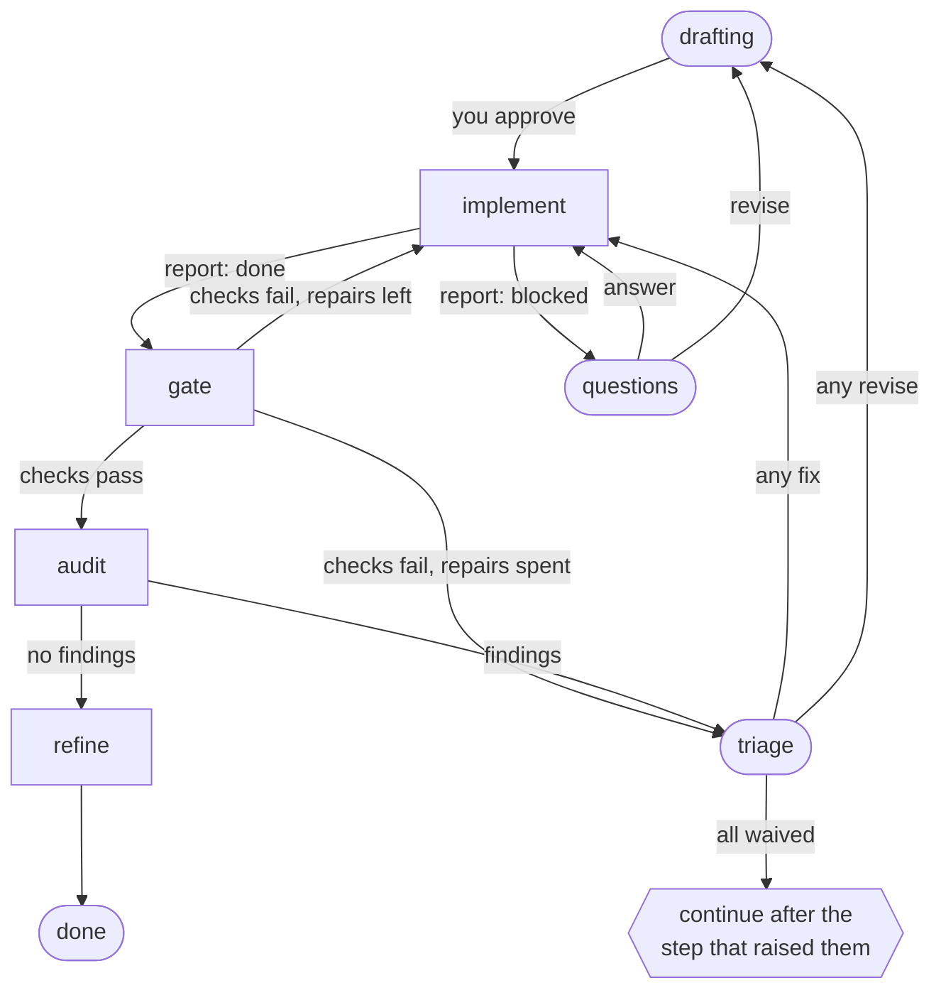

# Workflow

This document describes how a charter moves from an idea to a reviewed change, what each participant does, and what is stored on disk.

## Participants

| Who | Does |
| --- | --- |
| You, the developer | Describe the change, approve the charter, decide every question and finding, review the result, commit and merge. |
| The coordinator | The model in your main Pi session, in Charter mode. Drafts the documents with you, runs the tools, presents what needs your decision. It does not write the code and cannot move the workflow on its own authority. |
| Implementer | A separate agent session. Implements the approved charter and proves each acceptance criterion. |
| Project checks | Your own commands (tests, lint, type check), run by code. |
| Auditor | A separate agent session, ideally a different model. Verifies each acceptance criterion against the actual code. Read-only. |
| Refiner | A separate agent session. Simplifies the accepted code without changing behavior. Off by default. |

Every agent starts with a fresh conversation. It sees the approved documents and facts taken from disk and git, never another agent's reasoning or claims.

## Stages

The saved stage names the step the charter needs *next*. A run in flight is recorded separately, so a crash or cancellation leaves the charter exactly where a retry has to start.



Rounded stages wait for you. The others run without you, one after another, inside a single `charter_advance` (or `charter_approve`, or `charter_resolve`) call.

| Stage | Waiting for | Leaves when |
| --- | --- | --- |
| `drafting` | You | You approve documents that pass lint. |
| `implement` | Pipeline | The implementer reports `done` or `blocked`. |
| `questions` | You | You answer every open question. |
| `gate` | Pipeline | The project checks ran. |
| `audit` | Pipeline | Every auditor shard reported. |
| `triage` | You | You decide every open finding. |
| `refine` | Pipeline | The refiner reported, or the step was skipped. |
| `done` | Nobody | Never, unless you reopen the charter. |

Phases that are disabled, or have nothing to do, are passed over: with no checks configured `gate` is skipped; with the auditor disabled the work goes from the checks to the refiner or to `done`; with the implementer disabled approval leads straight to `done` and the approved documents are the deliverable.

## Documents

### brief.md

Four short sections, all required: **Why**, **Outcome**, **In scope**, **Out of scope**. It gives every agent the reason behind the spec and the boundary of the change.

### spec.md

The contract. Two kinds of headings carry structure:

- a requirement: `### R1: The <actor> MUST <observable outcome>`
- an acceptance criterion: `#### AC1: <one observable result>`

A requirement has fields, written as list items below its heading:

| Field | Required | Meaning |
| --- | --- | --- |
| `Change:` | yes | `added`, `modified` or `removed`, relative to how the system behaves today. |
| `Was:` | no | The previous behavior, when that helps to understand a modification or removal. |
| `Verified by:` | see below | Comma-separated criterion ids and/or existing tests: `test: path/to/file.test.ts > "scenario name"`. |

A requirement is verified by the criteria nested under it, by its `Verified by:` references, or both. It needs at least one of them. Use `Verified by:` to point at a criterion defined elsewhere or at an existing test that already covers the exact scenario; test paths are relative to the project root and must exist.

A criterion has one or more `- GIVEN`, `- WHEN` and `- THEN` items (`- AND` continues the previous clause) and a concrete example: a table with at least one data row, a fenced block, or a line starting with `Example:`.

Criteria that protect existing behavior, and belong to no new requirement, go under `## Regression checks`. Things the request left open and you took as given go under `## Assumptions` as a list; an assumption that turns out to be false during implementation is a reason for the implementer to stop and ask.

Write only what the change adds, modifies or removes. Describe behavior, not implementation.

### design.md

Optional. Create it only when a technical decision must be fixed before implementation. If it exists it must record something.

### attachments/

Optional. Any files below `attachments/` are part of the contract: they are hashed and frozen with the documents, and agents are pointed at them.

### Lint rules

`charter_lint` and `/charter lint` report these. Errors block approval; warnings do not.

| Rule | Severity | Meaning |
| --- | --- | --- |
| `missing-document` | error | `brief.md` or `spec.md` does not exist. |
| `brief-section` | error | A required section of the brief is missing or empty. |
| `design-empty` | error | `design.md` exists but records nothing. |
| `no-criteria` | error | The spec has no acceptance criterion. |
| `duplicate-requirement`, `duplicate-criterion` | error | An id is defined twice. |
| `requirement-title`, `requirement-must` | error | A requirement has no statement, or does not state an obligation with `MUST` / `MUST NOT`. |
| `requirement-change` | error | `Change:` is missing or not one of the three values. |
| `requirement-unverified` | error | A requirement has neither nested criteria nor `Verified by:`. |
| `verified-by-syntax`, `verified-by-unknown`, `verified-by-test-missing` | error | A reference cannot be read, names an undefined criterion, or points at a test file that does not exist. |
| `criterion-title`, `criterion-clause`, `criterion-example` | error | A criterion lacks a title, one of GIVEN / WHEN / THEN, or a concrete example. |
| `unresolved-placeholder` | error | `{{...}}`, `TBD`, `TODO`, `???` or `[NEEDS CLARIFICATION ...]` remains. Quote a literal with backticks to mention it. |
| `criterion-vague` | warning | A THEN clause uses words that cannot be measured ("correctly", "as expected", "user-friendly", ...). |
| `criterion-orphan` | warning | A criterion belongs to no requirement and is not a regression check. |
| `criterion-duplicate-title` | warning | Two criteria share a title. |

## Approval

Approval is yours alone. With a UI, `charter_approve` shows a dialog that states what you approve (documents, number of requirements and criteria, lint result) and what will run afterwards. Without a UI, the tool refuses and you type `/charter approve`.

On approval:

1. every document is hashed (SHA-256) and copied to `approved/<revision>/`;
2. a baseline checkpoint of the work tree is taken (first approval, git available);
3. the documents are frozen until the charter is reopened.

Frozen means: the file tools of the coordinator and of every agent refuse to write them; before each run the hashes are compared, and a mismatch stops the pipeline (your manual edit is kept, and `/charter reopen` lets you approve it); after each run they are compared again, and an agent's change is undone from the archived copy and recorded in the final report.

## Reports

Agents hand in results through a `charter_report` tool, which ends their run. A report that does not satisfy the rules is rejected with the list of problems, and the agent corrects it in the same session.

| Report | Rules enforced on submission |
| --- | --- |
| Implementer (`impl-N`) | One result with evidence per acceptance criterion of the spec, no more, no fewer. `done` requires every criterion to pass and no questions. `blocked` requires at least one question, each with title and detail. |
| Auditor (`audit-N`) | One result with evidence per *assigned* criterion. Every `fail` or `untested` needs a finding linked to that criterion. A finding cannot be linked to a criterion marked `pass`. Findings need title, severity, detail and evidence. |
| Refiner (`refine-N`) | A summary. |

An agent that stops without reporting is reminded once (`limits.reportNudges`). If it still does not report, the run counts as failed and nothing it claims is accepted.

Check results are saved as `gate-N` reports by the pipeline itself.

## Questions

The implementer reports `blocked` when a decision is not its to make: the spec is silent or contradictory about visible behavior, an assumption is false, the proper solution lies outside the scope, or something technical prevents completion. Each question comes with options, their consequences and a recommendation.

You answer every open question in one batch:

| Decision | Effect |
| --- | --- |
| `answer` | The approved spec stands. Your answer is binding for the next implementer run and is shown to the auditor. |
| `revise` | The answer changes the contract. The charter returns to `drafting`; you revise and approve again. |

If any question is decided `revise`, the charter returns to drafting.

## Project checks

Checks run after every implementer report, from the project root, each with its own time limit. All of them run even if one fails, so one repair pass sees everything.

- All pass: on to the audit.
- Some fail and repairs remain (`limits.gateRetries`, default 2): the implementer is started again with the failing output. This is not a new cycle and does not involve you.
- Some fail and repairs are spent: each failing check becomes a finding and the charter goes to `triage`.

## Audit

Each auditor verifies its assigned criteria against the code as it is: runs the existing tests, probes the behavior directly, reads the changed files. With `roles.auditor.shards` greater than 1, criteria are split into contiguous groups and audited concurrently in the same checkout; the reports are merged and findings numbered across shards. If one shard fails, the others still finish and their results are kept: advancing again re-runs only the failed shard, provided the project files are exactly as the finished auditors saw them (compared by work-tree snapshot). Without git there is nothing to compare, so the other shards are stopped and the audit is retried as a whole.

An auditor's `edit` and `write` tools work only inside a scratch directory created for the run. With git available, the work tree is snapshotted before and after the audit; any project file that differs is restored and listed in the audit report (`drift`) and in the final report. Before restoring, the changed state is saved as checkpoint `after-audit-N`, so an edit you made yourself during the audit is not lost.

No findings: on to the refiner or to `done`.

## Triage

Every finding needs your decision, whatever its severity:

| Decision | Effect |
| --- | --- |
| `fix` | The spec is right, the code is wrong. A new implementation cycle addresses the finding; then checks and the whole audit run again. |
| `waive` | Accepted as it is. Your reason is recorded, shown to later auditors so it is not raised again, and listed in the final report. |
| `revise` | The spec is wrong. The charter returns to `drafting`. |

`revise` outranks `fix`, which outranks `waive`: one `revise` returns the charter to drafting whatever the other decisions are.

## Refinement

The refiner may modify only the files the implementation changed since approval, and may add new files. After it reports:

1. if nothing changed, that is recorded;
2. if it modified or deleted a file outside that scope, the whole refinement is rolled back;
3. otherwise the checks run again, and if a check that passed on the accepted code now fails, the whole refinement is rolled back.

A refiner that fails midway has its partial changes undone. Whatever is rolled back is first saved as checkpoint `discarded-refine-N`, and the final report gives the `git diff` command to look at it. The refinement is not audited again; it relies on these guards and on your checks. Refinement needs git and is skipped without it.

## Budgets

| Budget | Default | When it is spent |
| --- | --- | --- |
| Implementation cycles per approval (`limits.cycles`) | 3 | The pipeline stops and asks you (dialog) or waits for `/charter go`, which grants one more cycle. |
| Automatic repairs per cycle (`limits.gateRetries`) | 2 | Failing checks are escalated to you as findings. |
| Time per agent run (`roles.<role>.timeoutMinutes`) | 60 / 30 / 30 | The run is stopped and counts as failed. |
| Time per check (`checks[].timeoutSeconds`) | 600 | The check is killed and counts as failed. |

A cycle starts at approval, after you answer questions, and after you decide `fix`. Automatic repairs and retries of failed runs are not cycles.

## Interruptions and recovery

- **Cancel** (Escape in Pi): the running agent or check is stopped, finished steps are kept, and the charter stays at the stage that was interrupted.
- **A run fails** (provider error, timeout, no report): the pipeline halts with the reason and the path of the agent's saved session. Advancing again retries that step.
- **Pi is closed or crashes**: start Pi again and run `/charter resume`. The stage is on disk; a run that was in flight is detected and retried on the next advance. In a resumed Pi session the mode and the active charter are restored automatically.
- **You want to undo**: `/charter rollback` restores the project files to the baseline (or a named checkpoint) and reopens the charter. Documents and reports are kept. The state before the rollback is saved as checkpoint `before-rollback-N`, so `/charter rollback before-rollback-1` undoes the undo.
- **You want to change the spec mid-flight**: `/charter reopen`.
- **A step is not worth it**: `/charter skip` moves past pending checks, audit or refinement and records that it was skipped by you.

Two Pi processes cannot drive the same charter at once; a lock file names the process that holds it.

## Checkpoints

With git available, these snapshots of the work tree are kept under `refs/charter/<id>/` and listed by `/charter status`:

| Checkpoint | Taken |
| --- | --- |
| `baseline` | At the first approval. The base for "what changed" and the default rollback target. |
| `pre-impl-N`, `pre-refine-N` | Before each implementer and refiner run. |
| `after-audit-N` | Only when project files differed after an audit, before they were restored. |
| `discarded-refine-N` | Before a refinement is rolled back. |
| `before-rollback-N` | Before `/charter rollback` restores files. |

Any of them can be inspected with ordinary git commands, for example `git diff refs/charter/001-csv-export/baseline refs/charter/001-csv-export/pre-refine-1`. `/charter prune` deletes the checkpoints of a finished charter.

## Completion

At `done`, `report.md` is generated from the saved reports: what was built, a table of every acceptance criterion with the implementer's and the auditor's result and evidence, the check results, every finding with its decision and reason, what happened to the refinement, what was skipped or disabled, notes such as restored files, and every run with model, duration and token usage. The coordinator presents it; it does not write it.

The pipeline never commits. Review, commit and merge are yours. With git available the report includes the `git diff` command that shows everything changed since approval.

## Files

```text
.charter/001-csv-export/
├── brief.md
├── spec.md
├── design.md              optional
├── attachments/           optional
├── charter.json           stage, approval, runs, usage, checkpoints
├── journal.jsonl          append-only event log
├── report.md              generated at completion
├── reports/
│   ├── impl-1.json
│   ├── gate-1.json
│   ├── audit-1.json
│   └── refine-1.json
└── approved/
    └── 1/                 exact copies of the documents at approval 1
```

References such as `impl-1/Q2` and `audit-2/F1` name question 2 of the first implementer report and finding 1 of the second audit report. Numbering restarts in each report.

Whether to commit `.charter/` is your choice. Committing the documents and reports keeps a record of why a change was made and how it was verified; `charter.json`, `journal.jsonl` and `.lock` describe a workflow in progress and are less useful in history.
